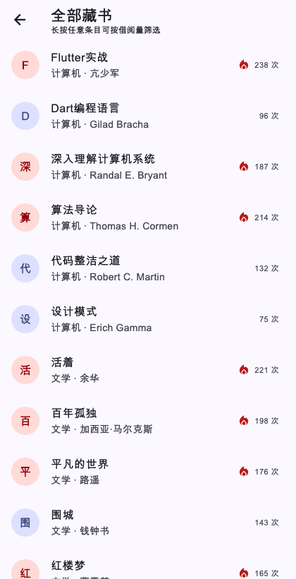
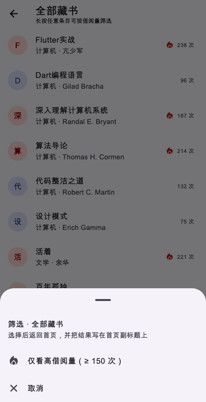

# 进度报告7（第9周·可滚动组件与多页面结构）

课堂作业七：app_skeleton 三页骨架复现 + 自主实践

仓库 <https://github.com/andyyang0907/lecture7-V2> ｜ 运行目标 Web/Android/iOS ｜ 2026-11-05

> 使用方式：按模板十节作答；全文可复制到雨课堂答题区，图片需在编辑器中重新上传；同一内容已存入仓库 docs/progress-report.md。

## 一、任务理解

本次作业是把第 7 课“可滚动组件与多页面结构”的案例 app_skeleton 自己搭起来：首页用 GridView 铺分类宫格，点分类进入 ListView.builder 列表页，列表项携带强类型 Book 参数跳到详情页，详情页再把借阅结果带回来。全程使用命名路由，每完成一步提交一次。

复现之外还要求自主实践：列表分页模拟（每次追加 20 条）、命名路由不少于 4 条、去程强类型参数且回程至少一处生效、至少 2 个参数化复用组件放进 lib/widgets/，并在 README 标注 AI 使用情况。

我把验收标准拆成三条：① 三页能跳通，代码里不出现裸 MaterialPageRoute；② 详情页参数不缺字段（不出现“未知书籍”）；③ 回传值能在界面上看出来（首页副标题或列表借阅次数变化）。

## 二、环境与工具

| 项目 | 配置 |
| --- | --- |
| 操作系统 | macOS 27.2（Apple Silicon arm64） |
| 框架版本 | Flutter 3.47.4 stable（channel stable） |
| 运行目标 | Chrome（Web）为主，android / ios 工程保留 |
| 数据来源 | assets/books.json：48 本藏书、8 个分类 |
| AI 工具 | TraeCode 内置助手（模型 DeepSeek-V4.1-Flash） |
| 验证手段 | flutter build web、flutter test（4 个行为测试）、golden 截图测试（5 张） |

## 三、过程记录

- 读课件 41 页，整理出案例主线与评分点；对照实践指南七列出三页流程与提交节奏。
- 在空仓库根目录执行 `flutter create --project-name app_skeleton --platforms=web,android,ios .`，得到可运行骨架。
- 第一次提交：工程骨架 + 列表页。写 Book 模型与 BookRepository，用 FutureBuilder + ListView.builder 渲染 48 条藏书。
- 第二次提交：命名路由。新增 AppRoutes 三个常量并在 MaterialApp.routes 注册；列表项 pushNamed 时把 Book 实例塞进 arguments；详情页用 `ModalRoute.of(context)!.settings.arguments as Book` 接收。
- 第三次提交：首页网格。GridView.builder 铺 8 个分类 + “全部藏书”入口；长按列表项弹出筛选层，选择后 pop 回首页，结果写在 AppBar 副标题。
- 第四次提交：自主实践。分页每次追加 20 条、详情页借阅结果经列表回传首页、抽取 BookTile / CategoryCard、补第 4 条路由 /about。
- 第五次提交：测试与文档。写 4 个行为测试并用 golden 测试生成 5 张手机尺寸截图；截图暴露首页卡片溢出，修复后跑通全部测试，补 README、AI 标注与本报告。

## 四、关键代码

**第 1 段：路由表（lib/main.dart）。** 把四个页面地址集中注册，跳转处只需写路由名。

```dart
routes: {
  AppRoutes.home: (_) => const HomePage(),
  AppRoutes.list: (_) => const BookListPage(),
  AppRoutes.detail: (_) => const BookDetailPage(),
  AppRoutes.about: (_) => const AboutPage(),
},
initialRoute: AppRoutes.home,
```

逐行说明：routes 是 MaterialApp 的命名路由表，键就是 pushNamed 用的字符串；initialRoute 指定启动页。AI 生成初稿，我核对路由名与 AppRoutes 常量是否一一对应，并用 /about 测试确认第 4 条路由真的能进。

**第 2 段：详情页接收参数与回传（lib/pages/book_detail_page.dart）。**

```dart
final book = ModalRoute.of(context)!.settings.arguments as Book;
...
FilledButton.icon(
  onPressed: () => Navigator.pop(
    context,
    BorrowResult(bookId: book.id, title: book.title,
                 borrowCount: book.borrowCount + 1),
  ),
  label: const Text('借阅这本书'),
),
```

逐行说明：ModalRoute.of(context) 取当前路由对象，settings.arguments 就是上一页 arguments 塞进来的对象；as Book 是强类型断言，字段拼错会在编译期或运行期立刻暴露，而不是静默显示“未知书籍”。pop 的第二个参数就是回程带货，发起方必须 await 才能拿到。验证：测试断言详情页出现“亢少军”“238 次”，借阅后列表变为“239 次”。

**第 3 段：分页页脚（lib/pages/book_list_page.dart）。**

```dart
itemCount: visible.length + 1,   // 末尾多一项做页脚
...
if (index == visible.length) {
  return hasMore
      ? FilledButton.tonal(
          onPressed: () => setState(() => _visibleCount += pageSize),
          child: Text('加载更多（已显示 ${visible.length}/${books.length} 条）'),
        )
      : Center(child: Text('已经到底了，共 ${books.length} 条'));
}
```

逐行说明：列表末尾固定多一项作为页脚；hasMore 用“已显示条数 < 总数”判断；点击后 setState 让 _visibleCount 加 20，ListView.builder 只重建可见项，滚动位置不跳。验证：测试从“20/48”点到“40/48”。

## 五、检查点结果

| 检查项 | 结果 | 证据 |
| --- | --- | --- |
| 三页跳转闭环 | 通过 | 测试“三页闭环”：首页→列表→详情→返回 |
| 详情页参数正确 | 通过 | 作者、分类、借阅次数、简介齐全（图3） |
| 回传值生效 | 通过 | 列表 238→239 次；首页副标题显示回传文案（图5） |
| 分页每次 +20 | 通过 | 测试 20/48 → 40/48 |
| 命名路由 ≥4 条 | 通过 | /、/list、/detail、/about |
| 复用组件 ≥2 个 | 通过 | BookTile、CategoryCard 均在 lib/widgets/ |
| 自动化测试 | 通过 | flutter test：9 项全部通过 |

## 六、问题与调试

**记录 1：窄屏下首页宫格卡片溢出。**

现象：用 420×820 的手机尺寸生成截图时，每张卡片底部出现黄黑斜纹，控制台报 “A RenderFlex overflowed by 18 pixels on the bottom”。

定位：溢出发生在 CategoryCard 的 Column。卡片高度由 GridView 的 childAspectRatio 决定：卡宽 (420 − 32 − 12)/2 = 188，1.55 对应高 121；内容为上下 padding 32 + 图标容器 40 + 标题 22 + 间距 4 + 副标题 22 ≈ 120~125，正好卡在临界值。

解决：把 childAspectRatio 由 1.55 调到 1.35（高度 139），留出约 15 的余量。

验证：重新生成 5 张截图，斜纹消失；flutter test 全绿；修复随第五次提交一起入库。

**记录 2：本机中文路径下 flutter analyze 直接崩溃。**

现象：在“移动软件开发实践/七/lecture7-V2”里执行 flutter analyze，analysis server 报 `Unterminated string at character 521` 后退出，一条诊断都不返回。

定位：报错出现在 LSP 初始化消息解析阶段，怀疑与路径中的中文有关；把同一份代码复制到纯 ASCII 路径下再跑 analyze 就正常（No issues found），说明不是代码问题。

解决：主验证改用 flutter build web 与 flutter test；需要 lint 时同步到 ASCII 路径再 analyze。这条也提醒我：工具报错先分清是环境还是代码。

**记录 3：长按弹层与页面返回的 context 不能混用。**

实现时发现：弹层里必须先 `Navigator.pop(sheetContext)` 关掉弹层，再 `Navigator.pop(context)` 退出列表页并回传值；两个 context 用反会导致弹层消失但页面没退、或者整条导航栈被误弹。代码里用 sheetContext 显式区分。

## 七、AI 使用记录

| 用途 | 指令摘要 | 输出 | 本人验证方式 |
| --- | --- | --- | --- |
| 课件解析 | 读 m7 课件 41 页，提取主线与评分点 | 三页流程 + 自主实践 5 条 | 对照作业要求 docx 逐条核对 |
| 工程分层 | 在空仓库建工程，按 pages/models/widgets/routes 分层 | 目录骨架 | flutter build web 通过 |
| 数据与模型 | 生成 Book.fromJson、仓库缓存、48 条书目 JSON | 模型与数据文件 | 首页显示 48 本 / 8 分类 |
| 路由与传参 | 用命名路由 + 强类型 arguments 完成列表→详情 | AppRoutes 与接收代码 | 测试断言详情字段正确 |
| 回传值 | 详情 pop 借阅结果，经列表回首页副标题 | BorrowResult / BookListResult | 测试断言 238→239 与副标题 |
| 分页 | 仿哨兵标记思路，每次加载 20 条 | 页脚按钮实现 | 测试 20/48 → 40/48 |
| 排错 | 给出截图与溢出报错，让 AI 分析原因 | 定位到 childAspectRatio | 重截图确认 + 回归测试 |
| 报告 | 按模板十节整理草稿 | 本报告结构 | 本人补命令、提交号与自查结论 |

标注原则：AI 负责生成初稿和候选方案，是否采用由我用运行结果判断；每条都写明了验证方式，源码关键处也留了“AI 辅助”注释。

## 八、证据截图

| 图1 网格首页 | 图2 列表页 |
| --- | --- |
|  |  |

| 图3 详情页 | 图4 长按筛选弹层 |
| --- | --- |
|  |  |

图5 首页副标题显示列表页回传的筛选结果：


运行与提交证据（终端输出摘录）：

```
$ git log --oneline
test & docs: flow tests, screenshots, overflow fix & report
feat: pagination, borrow return & reusable widgets
feat: grid home & pop-with-value filter
feat: named routes & typed arguments
feat: scaffold app_skeleton & list page with builder

$ flutter test
00:01 +9: All tests passed!
```

## 九、自评

| 作业要求 | 自查结论 |
| --- | --- |
| 三页骨架按指南步骤实现 | 完成：首页网格 → 列表 → 详情，每步一次提交 |
| 详情页参数正确 | 完成：强类型 Book 直传，作者/分类/借阅次数/简介齐全 |
| 回传值生效 | 完成：详情→列表（借阅次数 +1）、列表→首页（副标题） |
| 提交节奏与 README | 完成：5 次语义化提交，README 含结构、路由、清单与 AI 标注 |
| 自主实践 4 项 | 完成：分页 +20、4 条命名路由、强类型参数与回传、2 个复用组件 |
| 独立研究任务（选做） | 未完成：本次没有做，时间和精力优先保证必做项质量 |
| 报告十节 | 完成：本文件 + 同步生成的 docx |

自评：必做项与四项自主实践均已完成并用测试/截图验证；选做的独立研究任务没有做，这一点如实说明。

## 十、一句话收获与下一步计划

一句话收获：一万条列表不卡的根源是 Sliver 按需加载；而“路由闭环”就是路由表集中注册、arguments 去程带货、pop 回程带货三件事，回程那一步记得 await。

下一步：第 11 课接真实数据时，把 BookRepository 的本地 JSON 换成网络请求并接上 RefreshIndicator；借阅次数改为服务端写回；底部导航用 IndexedStack 保住各页 State，避免切页丢状态。

遗留问题：本机中文路径下 flutter analyze 不稳定，只能借 ASCII 路径跑 lint；Web 端 Canvas 渲染让浏览器里的无障碍点击不便，交互验证改用 widget test。
